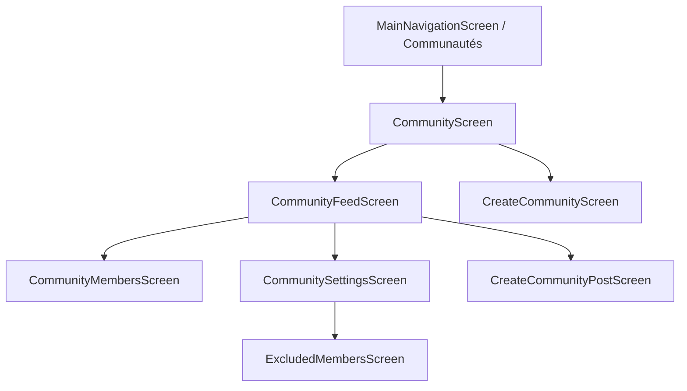

# Rapport d'Audit Complet : Module Communautés (Scrole Flutter)

Ce rapport présente l'analyse technique et fonctionnelle approfondie du module **Communautés** (`module_communautes`) et de ses interactions dans l'application Scrole. Aucune modification n'a été apportée au code source ou au backend conformément aux instructions.

---

## 1. Résumé Exécutif

Le module **Communautés** de Scrole est structuré autour d'une architecture hybride combinant persistance locale (SQLite via `AppDatabase`) et synchronisation distante avec Supabase (Repositories, RPC, Realtime).
- **Points forts** : Gestion robuste de l'outbox pour la création hors-ligne de communautés, synchronisation automatique au démarrage et à la reprise de l'application, mise en cache locale des listes de communautés et des publications.
- **Points d'attention (P1/P2)** : Le contrôleur du fil d'actualité de communauté (`CommunityFeedController`) utilise encore partiellement des données mockées/statiques pour l'initialisation des posts comparé au flux réel du fil général (`HomeFeedController`), et certaines liaisons de navigation nécessitent une harmonisation rigoureuse des paramètres.

---

## 2. Arborescence Réelle du Module

```text
lib/modules/module_communautes/
├── centre/
│   ├── models/
│   │   ├── community_model.dart
│   │   └── news/
│   └── │       └── community_hashtag.dart
│   ├── persistence/
│   │   └── community_local_dao.dart
│   └── services/
│       ├── community_outbox_processor.dart
│       └── community_service.dart
├── externe/
│   └── repositories/
│       └── community_repository.dart
└── interne/
    ├── controllers/
    │   └── community/
    │       ├── community_controller.dart
    │       └── community_feed_controller.dart
    ├── pages/
    │   ├── community_feed_screen.dart
    │   ├── community_members_screen.dart
    │   ├── community_poll_composer_screen.dart
    │   ├── community_post_hashtag_selection_screen.dart
    │   ├── community_post_mentions_screen.dart
    │   ├── community_post_settings_screen.dart
    │   ├── community_screen.dart
    │   ├── community_settings_screen.dart
    │   ├── create_community_post_screen.dart
    │   ├── create_community_screen.dart
    │   └── excluded_members_screen.dart
    └── widgets/
        └── community/
            └── poll_card_widget.dart
```

---

## 3. Inventaire des Écrans

1. **CommunityScreen** (`interne/pages/community_screen.dart`)
   - *Rôle* : Écran principal affichant la liste des communautés rejointes par l'utilisateur (avec indicateurs de statut *pending* ou *confirmed*).
   - *Contrôleur* : `CommunityController`.
   - *Repositories/Services* : `CommunityService`.
   - *Actions* : Créer une communauté, rafraîchir, ouvrir une communauté (vers `CommunityFeedScreen`).
   - *États* : Chargement (Lottie), liste vide (bouton de création), liste des communautés, indicateur de création en cours.

2. **CommunityFeedScreen** (`interne/pages/community_feed_screen.dart`)
   - *Rôle* : Fil d'actualité et espace d'échanges d'une communauté spécifique.
   - *Contrôleur* : `CommunityFeedController`.
   - *Actions* : Publier un post, voter à un sondage, réagir, commenter, accéder aux membres et paramètres.

3. **CreateCommunityScreen** (`interne/pages/create_community_screen.dart`)
   - *Rôle* : Formulaire de création de communauté (Nom, slug, description, avatar, couverture, visibilité).
   - *Contrôleur* : `CommunityController`.
   - *Actions* : Validation, sélection d'images (avatar / bannière), mise en file d'attente (outbox).

4. **CommunitySettingsScreen** (`interne/pages/community_settings_screen.dart`)
   - *Rôle* : Paramètres généraux, visibilité, règles d'accès, rôles et permissions.

5. **CommunityMembersScreen** (`interne/pages/community_members_screen.dart`)
   - *Rôle* : Gestion des membres, rôles (admin, modérateur, membre), certification, et exclusion.

6. **ExcludedMembersScreen** (`interne/pages/excluded_members_screen.dart`)
   - *Rôle* : Gestion et réintégration des membres exclus d'une communauté.

7. **CreateCommunityPostScreen** (`interne/pages/create_community_post_screen.dart`)
   - *Rôle* : Éditeur de publication de communauté (texte, photos, sondage, hashtags, mentions, paramètres de commentaires/partage).

---

## 4. Analyse des Contrôleurs GetX

- **CommunityController** (`interne/controllers/community/community_controller.dart`)
  - *Responsabilité* : Gestion de la liste des communautés de l'utilisateur, déclenchement de la synchronisation locale, vérification des expirations d'outbox et création de nouvelles communautés.
  - *Réactifs* : `communities` (`RxList<CommunityModel>`), `isLoading` (`RxBool`).
- **CommunityFeedController** (`interne/controllers/community/community_feed_controller.dart`)
  - *Responsabilité* : Gestion du fil d'actualité d'une communauté, des publications, des sondages et des commentaires.
  - *Limites* : Initialise actuellement une liste de posts statique/mockée dans `fetchCommunityFeed()`, nécessitant un raccordement complet avec `HomeFeedRepository` / `CommunityRepository` pour charger les posts réels de la communauté.

---

## 5. Repositories, Services et Modèles

- **CommunityRepository** (`externe/repositories/community_repository.dart`) : Encapsule les appels Supabase RPC (`create_community`, `get_my_communities`, `leave_community`, `delete_post`, etc.).
- **CommunityService** (`centre/services/community_service.dart`) : Service métier et cycle de vie (`WidgetsBindingObserver`), gère les abonnements Realtime (`community_membership_removed`), la réconciliation avec le serveur et le déclenchement de l'outbox.
- **CommunityOutboxProcessor** (`centre/services/community_outbox_processor.dart`) : Traitement en arrière-plan des opérations hors-ligne (ex: `create_community`) avec backoff exponentiel.
- **CommunityLocalDao** (`centre/persistence/community_local_dao.dart`) : Accès SQLite pour la persistance locale (`communities`, `community_settings`, `community_outbox`, `community_feed_cache`).
- **CommunityModel** (`centre/models/community_model.dart`) : Modèle de données représentant une communauté.

---

## 6. Architecture des Données (Flux)

```text
[UI Screen] → [GetX Controller] → [CommunityService]
                                       ↓
                               [CommunityRepository]
                                       ↓
                        [Supabase RPC / Storage] & [CommunityLocalDao (SQLite)]
```

---

## 7. Cache et Fonctionnement Hors Ligne

- **Persistance SQLite** : Tables locales pour les communautés, les membres, les paramètres et les caches de fil d'actualité.
- **Outbox Pattern** : Enregistrement local des actions de création en cas de hors-ligne, traitées automatiquement par `CommunityOutboxProcessor` dès le rétablissement de la connexion.

---

## 8. Routes et Navigation

- Points d'entrée principaux depuis le shell de navigation (`MainNavigationScreen` ou `MainShell`).
- Routes paramétrées via `AppPages` (`/communities/:id`, `/communities/preview/:id`).



---

## 9. Tableau des Fonctionnalités Existantes

| Fonctionnalité | Écran concerné | État constaté | Fichiers impliqués | Limites ou problèmes |
|---|---|---|---|---|
| Liste des communautés | `CommunityScreen` | Implémentée et vérifiée | `community_screen.dart`, `community_controller.dart` | Aucun |
| Création de communauté | `CreateCommunityScreen` | Implémentée et vérifiée | `create_community_screen.dart`, `community_outbox_processor.dart` | Paramètres RPC corrigés (p_photo_profile, etc.) |
| Fil d'actualité de communauté | `CommunityFeedScreen` | Partiellement implémentée | `community_feed_screen.dart`, `community_feed_controller.dart` | `fetchCommunityFeed` utilise des données mockées |
| Gestion des membres | `CommunityMembersScreen` | Implémentée et vérifiée | `community_members_screen.dart`, `community_repository.dart` | - |
| Paramètres & Règles | `CommunitySettingsScreen` | Implémentée | `community_settings_screen.dart` | - |

---

## 10. Problèmes et Incohérences (Classés par Priorité)

- **P1 — Important** : `CommunityFeedController.fetchCommunityFeed()` renvoie des données factices au lieu de charger les publications réelles de la communauté depuis le repository.
- **P2 — Moyen** : Gestion des erreurs réseau dans certains écrans secondaires nécessitant des retours utilisateur uniformes.

---

## 11. Éléments Nécessitant une Vérification du Backend

- Validation exacte des contraintes RLS sur les tables `communities` et `community_members` lors de l'insertion de posts par des non-membres.

---

## 12. Plan de Travail Proposé

1. **Raccorder `CommunityFeedController`** au repository pour charger les publications réelles de la communauté au lieu des mocks.
2. **Vérifier la navigation et le passage de paramètres** entre la liste des communautés et les écrans de détail.
3. **Tester les flux de publication et de modération** au sein d'une communauté.
